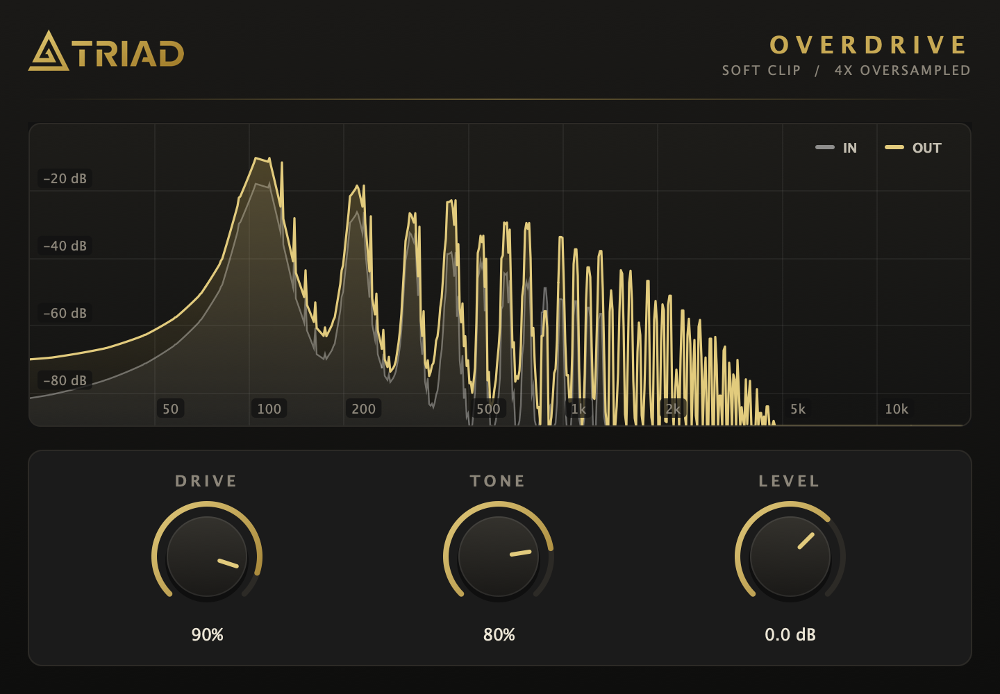

# Sonic Lab

Triad's collection of audio plugins. Each plugin builds as its own Audio Unit
(`.component`) for GarageBand and Logic on macOS. They share one copy of JUCE
and a common set of Triad branding, styling and analysis code.

| Plugin | Folder | AU codes | What it does |
| --- | --- | --- | --- |
| Triad Overdrive | [`plugins/TriadOverdrive`](plugins/TriadOverdrive) | `aufx Ovd1 Trdt` | Guitar overdrive: Drive, Tone and Level, 4x-oversampled soft clipping, live input/output spectrum |



## Layout

```
CMakeLists.txt          builds JUCE, the shared module and every plugin
cmake/TriadPlugin.cmake triad_add_plugin(): Triad defaults for each plugin
external/JUCE/          JUCE, a git submodule pinned to a release tag
shared/triad_shared/    JUCE module shared by all plugins
  ui/                     TriadLookAndFeel, TriadHeader, SpectrumAnalyzer
  dsp/                    SpectrumTap (audio thread -> UI sample handoff)
shared/assets/          Triad logo, embedded as TriadAssets
plugins/<Name>/         one folder per plugin: CMakeLists.txt + Source/
tools/EditorSnapshot/   renders a plugin's window to a PNG (optional)
scripts/                build, install and validate
```

## Requirements

- macOS with the Xcode Command Line Tools (`xcode-select --install`)
- CMake and Ninja: `brew install cmake ninja`

## Getting started

Clone with the JUCE submodule:

```bash
git clone --recurse-submodules https://github.com/Sonic-Triad/sonic-lab.git
```

Build every plugin, install it to `~/Library/Audio/Plug-Ins/Components` and run Apple's `auval` validator on it:

```bash
scripts/build_and_install.sh
```

Or just one:

```bash
scripts/build_and_install.sh TriadOverdrive
```

Restart GarageBand afterwards so it picks up the new version.

## Adding a plugin

1. Create `plugins/<Name>/` with a `Source/` folder (copying `TriadOverdrive` is the quickest start).
2. Add `plugins/<Name>/CMakeLists.txt`:

   ```cmake
   triad_add_plugin(<Name>
       PRODUCT_NAME "Triad <Something>"
       VERSION 1.0.0
       PLUGIN_CODE Abc1          # 4 characters, unique in this repo, at least one uppercase
       BUNDLE_SUFFIX something   # bundle ID becomes tech.triad.something
       SOURCES
           Source/PluginProcessor.cpp
           Source/PluginEditor.cpp)
   ```

3. Include `<triad_shared/triad_shared.h>` to use `TriadLookAndFeel`, `TriadHeader`, `SpectrumAnalyzer` and `SpectrumTap`.
4. Add the plugin to the table above, then run `scripts/build_and_install.sh <Name>`.

The root CMakeLists picks up any folder in `plugins/` that has a `CMakeLists.txt`.
Every plugin uses the manufacturer code `Trdt`, so GarageBand groups them under
"Triad". Never reuse a `PLUGIN_CODE`, and never change one after release:
GarageBand projects use it to find the plugin.

## Window snapshots

To check a plugin's window without opening GarageBand, build its snapshot tool.
It plays a test guitar note through the plugin and saves the window as a PNG:

```bash
cmake -S . -B build-snapshot -G Ninja -DCMAKE_BUILD_TYPE=Release -DSONIC_LAB_BUILD_SNAPSHOT_TOOL=ON
cmake --build build-snapshot --target TriadOverdriveSnapshot
build-snapshot/plugins/TriadOverdrive/TriadOverdriveSnapshot_artefacts/Release/TriadOverdriveSnapshot out.png drive=0.9 tone=0.8
```

Parameter values are normalised from 0 to 1.

## Distribution

The build script signs plugins ad hoc, which is enough to run them on this Mac.
To share a plugin with other people, sign it with a Developer ID certificate
and notarize it with Apple.
